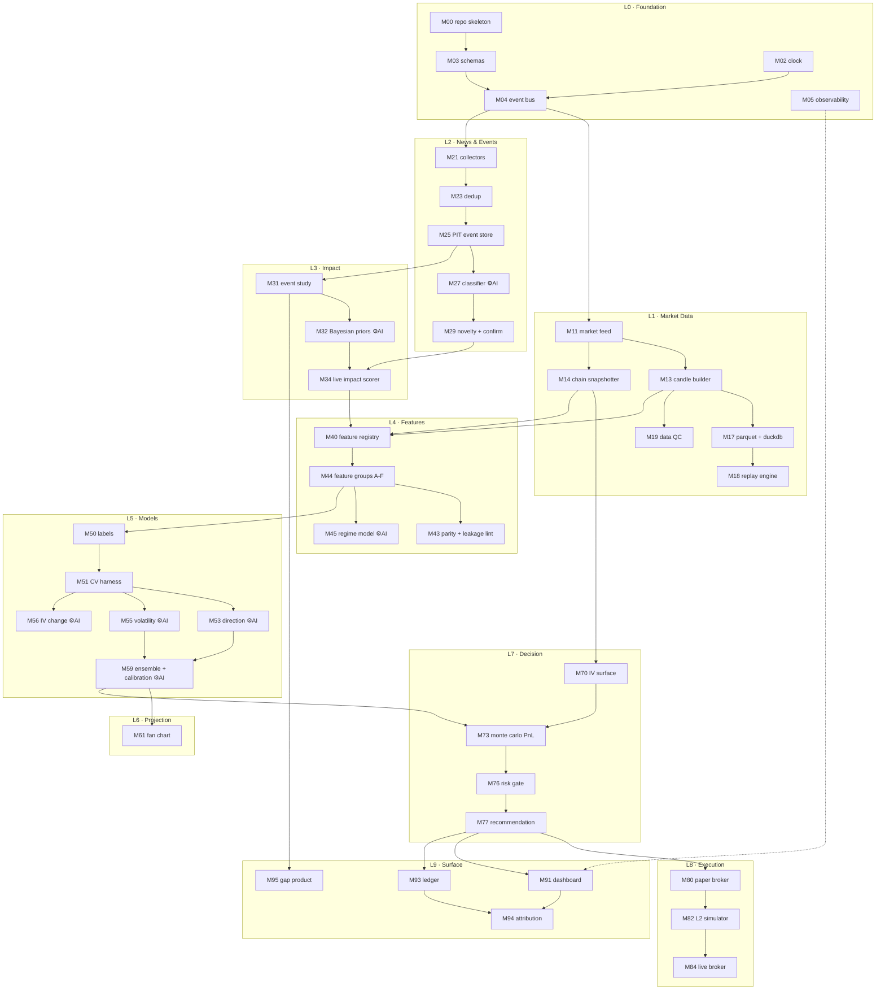

# MarketSage AI — MEGAPLAN

> **Working execution document.** The LaTeX blueprint in `docs/` says *what to build and why*.
> This file says *what to build next, in what order, and how to prove it works*.
>
> Companion files: `docs/pdf/marketsage_master_plan.pdf` (strategy) · `docs/gates.md` (phase sign-off)

---

## 0. Rules of engagement

Read these once. They are the difference between a system and a pile of scripts.

| # | Rule | Why |
|---|------|-----|
| R1 | **A module is not done until its `Verify` block passes.** Not "it runs" — the verify command exits 0. | Prevents the 80%-done graveyard |
| R2 | **Every module has exactly one owner concept.** If you can't state it in one line, split it. | Keeps interfaces clean |
| R3 | **Modules talk through schemas, never by importing each other's internals.** | Lets you rewrite any module without touching the rest |
| R4 | **Point-in-time or it doesn't exist.** Every record carries `t_event`, `t_ingest`, `t_available`. | This single rule prevents the most expensive class of bug |
| R5 | **No magic numbers.** All thresholds in `config/*.yaml`, hash logged with every decision. | Reproducibility |
| R6 | **Clock is injected, never `datetime.now()` in library code.** | The simulator and production must share one code path |
| R7 | **Any order-placing function takes `live: bool = False`.** | The one bug you cannot afford |
| R8 | **Build the boring module before the fun one.** Recorder before model. Baseline before transformer. | See kill criteria at G5 |
| R9 | **When in doubt, emit nothing.** No-trade is the correct default output. | |
| R10 | **Write the verify test before the implementation.** | Forces you to define "working" |

### Status legend
`☐` not started · `◐` in progress · `☑` verified · `⊘` deferred/descoped · `✖` blocked

---

## 1. System design — the module map



### Design invariants

| Invariant | Enforced by |
|---|---|
| No module reads another module's database tables directly | Code review + `libs/` boundaries |
| Every bus message validates against a versioned schema | M03 + M04 runtime validation |
| Offline and online feature values are identical | M43 parity test in CI |
| A recommendation can be traced back to the raw news item | M05 trace-id propagation |
| Replaying a day produces byte-identical output | M18 determinism test |
| Nothing can place a real order except M84, and only when `live=True` | M76 risk gate + code convention R7 |

---

## 2. Module index

Phase column maps to the gates in `docs/gates.md`. Build strictly top-down within a phase.

| ID | Module | Layer | Phase | Depends on | AI/ML | Status |
|----|--------|-------|-------|-----------|:-----:|:------:|
| **M00** | Repo skeleton & Docker stack | L0 | P0 | — | | ◐ |
| **M01** | Config registry (YAML + hashing) | L0 | P0 | M00 | | ☑ |
| **M02** | Clock & session calendar | L0 | P0 | M00 | | ☑ |
| **M03** | Schemas & contracts | L0 | P0 | M00 | | ☑ |
| **M04** | Event bus (Redis Streams) | L0 | P0 | M03 | | ☑ |
| **M05** | Observability (logs, traces, metrics) | L0 | P0 | M00 | | ☑ |
| **M06** | Secrets & environment isolation | L0 | P0 | M00 | | ☑ |
| **M10** | Instrument master & calendars | L1 | P0 | M01 | | ◐ |
| **M11** | Market feed adapter | L1 | P0 | M04, M10 | | ☑ |
| **M12** | Raw tick recorder | L1 | P0 | M11 | | ☑ |
| **M13** | Candle builder | L1 | P1 | M12, M02 | | ☑ |
| **M14** | Option chain snapshotter | L1 | P0 | M11 | | ☑ |
| **M15** | Cross-asset collector | L1 | P1 | M04 | | ☑ |
| **M15b** | Daily bar loader (free source) | L1 | P4 | M15 | | ☑ |
| **M16** | TimescaleDB schema & loaders | L1 | P1 | M03 | | ☑ |
| **M17** | Parquet archive + DuckDB research layer | L1 | P1 | M16 | | ☑ |
| **M18** | Replay engine | L1 | P1 | M17, M02, M04 | | ☑ |
| **M19** | Data quality gates | L1 | P1 | M16 | | ☑ |
| **M20** | Source registry & credibility weights | L2 | P2 | M01 | | ☐ |
| **M21** | Collector framework | L2 | P2 | M04, M20 | | ☐ |
| **M22** | Normaliser & publish-time resolver | L2 | P2 | M21 | | ☐ |
| **M23** | Deduplication | L2 | P2 | M22 | ⚙ | ☐ |
| **M24** | Economic calendar & consensus | L2 | P2 | M21 | | ☐ |
| **M25** | Point-in-time event store | L2 | P2 | M22, M16 | | ☐ |
| **M26** | Relevance gate (tier 1) | L2 | P3 | M25 | ⚙ | ☐ |
| **M27** | Event classifier (tier 2) | L2 | P3 | M26 | ⚙ | ☐ |
| **M28** | Entity/geo extraction & KG routing | L2 | P3 | M27 | ⚙ | ☐ |
| **M29** | Novelty, confirmation, credibility fusion | L2 | P3 | M27, M13 | ⚙ | ☐ |
| **M30** | Abnormal-return engine | L3 | P4 | M13, M17 | | ☑ |
| **M31** | Event-study runner | L3 | P4 | M30, M25 | | ☑ |
| **M32** | Hierarchical Bayesian impact priors | L3 | P4 | M31 | ⚙ |☑ |
| **M33** | Cross-asset transfer estimator | L3 | P4 | M15, M30 | ⚙ |☑ |
| **M34** | Live impact scorer | L3 | P4 | M32, M29 | | ☐ |
| **M35** | Overnight gap forecaster | L3 | P4 | M33, M31 | ⚙ |☑ |
| **M35a** | Model audit: null tests for every fitted component | L5 | P4 | M32, M33, M35 | | ☑ |
| **M40** | Feature registry & framework | L4 | P5 | M03, M17 | | ☑ |
| **M41** | Offline materialiser | L4 | P5 | M40 | | ☑ |
| **M42** | Online feature server | L4 | P5 | M40, M04 | | ☑ |
| **M43** | Parity test & leakage linter | L4 | P5 | M41, M42 | | ☑ |
| **M44** | Feature groups A–F | L4 | P5 | M43 | | ◐ |
| **M45** | Regime model | L4 | P5 | M44 | ⚙ | ☐ |
| **M50** | Label builder (triple barrier) | L5 | P5 | M13, M44 | | ☑ |
| **M51** | CV harness (purged / embargo / CPCV) | L5 | P5 | M50 | | ☑ |
| **M52** | M0 rules baseline | L5 | P5 | M34, M44 | | ☑ |
| **M53** | Direction model (boosted trees + isotonic) | L5 | P5 | M51 | ⚙ | ☑ |
| **M54** | Quantile model | L5 | P6 | M51 | ⚙ | ☐ |
| **M55** | Volatility model | L5 | P5 | M51 | ⚙ | ☐ |
| **M56** | IV-change model | L5 | P7 | M51, M70 | ⚙ | ☐ |
| **M57** | Meta-labeller | L5 | P5 | M53 | ⚙ | ☐ |
| **M58** | Sequence models (TCN / transformer) | L5 | P6 | M51, M13 | ⚙ | ⊘ |
| **M59** | Ensemble, calibration, conformal | L5 | P5 | M53, M55 | ⚙ | ☐ |
| **M5A** | Model registry & ONNX serving | L5 | P5 | M59 | | ☐ |
| **M60** | Path sampler | L6 | P6 | M55, M54 | ⚙ | ☐ |
| **M61** | Fan-chart producer | L6 | P6 | M60 | | ☐ |
| **M62** | Projection scorer (pinball/CRPS/PIT) | L6 | P6 | M61 | | ☐ |
| **M70** | IV surface fitter | L7 | P7 | M14 | | ☐ |
| **M71** | Greeks engine | L7 | P7 | M70 | | ◐ |
| **M72** | Structure enumerator & liquidity filter | L7 | P7 | M71 | | ☐ |
| **M73** | Monte Carlo P&L engine | L7 | P7 | M72, M60, M56 | | ☐ |
| **M74** | Cost model | L7 | P7 | M01 | | ☐ |
| **M75** | Position sizing | L7 | P7 | M73, M59 | | ☐ |
| **M76** | Risk gate & kill switches | L7 | P7 | M75 | | ☐ |
| **M77** | Recommendation assembler | L7 | P7 | M76 | | ☐ |
| **M80** | Paper broker adapter | L8 | P7 | M77 | | ☐ |
| **M81** | Fill & slippage model | L8 | P7 | M80 | ⚙ | ☐ |
| **M82** | L2 event-driven simulator | L8 | P7 | M18, M81 | | ☐ |
| **M83** | Order state machine & reconciliation | L8 | P8 | M80 | | ☐ |
| **M84** | Live broker adapter | L8 | P9 | M83, M76 | | ☐ |
| **M85** | Stress-scenario suite | L8 | P7 | M82 | | ☐ |
| **M90** | API gateway & WebSocket | L9 | P8 | M04 | | ☐ |
| **M91** | Dashboard UI | L9 | P8 | M90 | | ☐ |
| **M92** | Alerting | L9 | P8 | M90 | | ☐ |
| **M93** | Paper ledger & outcome resolver | L9 | P8 | M80 | | ☐ |
| **M94** | Attribution & calibration reports | L9 | P8 | M93 | | ☐ |
| **M95** | Morning briefing product | L9 | P4 | M35 | | ☐ |
| **MA0** | Orchestration (Prefect) | LX | P5 | M00 | | ☐ |
| **MA1** | Daily rhythm jobs | LX | P8 | MA0 | | ☐ |
| **MA2** | Retraining pipeline | LX | P8 | M5A, MA0 | ⚙ | ☐ |
| **MA3** | Drift monitors | LX | P8 | M94 | ⚙ | ☐ |
| **MA4** | CI pipeline | LX | P1 | M18, M43 | | ☐ |
| **MA5** | Backup & restore | LX | P1 | M16 | | ☐ |

**Count:** 79 modules · 20 carry AI/ML · 16 model cards in section 4 · every module has a verify block below.

---

## 3. Module specifications

Each spec is deliberately short. The pattern is always the same:
**Owns → Contract → Tasks → Verify → Done → Traps.**

---

### L0 · FOUNDATION

#### M00 · Repo skeleton & Docker stack
**Owns:** the shell everything else lives in.
**Contract:** `docker compose up` yields Postgres+TimescaleDB, Redis, and a health-checked service stub.

**Tasks**
- [ ] Monorepo layout per blueprint Ch.18 (`libs/`, `services/`, `jobs/`, `tests/`, `config/`)
- [ ] `pyproject.toml`, one virtualenv, pinned lockfile
- [ ] `docker-compose.yml`: timescaledb, redis, adminer (dev only)
- [ ] Pre-commit: ruff, black, mypy (libs only), **secret scanner**
- [ ] `Makefile` / `tasks.py`: `up`, `down`, `test`, `lint`, `record`

**Verify**
```bash
docker compose up -d && sleep 10
pytest tests/unit/test_smoke.py       # asserts DB + Redis reachable
pre-commit run --all-files            # exits 0
```
**Done:** clean machine → clone → `make up` → smoke test green in under 5 minutes.
**Traps:** don't add Kubernetes. Don't add a web framework yet.

---

#### M01 · Config registry
**Owns:** all tunable numbers, with provenance.
**Contract:** `Config.load()` → frozen object + `config_hash` string logged with every decision.

**Tasks**
- [ ] `config/{instruments,costs,risk_limits,sources,taxonomy,models}.yaml`
- [ ] Pydantic models for each; fail loudly on unknown keys
- [ ] `config_hash` = sha256 of the resolved config
- [ ] Cost tables are **dated** — `effective_from` per row, resolved point-in-time

**Verify**
```bash
pytest tests/unit/test_config.py -k "hash_stable or rejects_unknown_key or cost_is_pit"
grep -rn "0\.\|[0-9]\{2,\}" libs/ --include=*.py | grep -v test | grep -vE "^\s*#"  # review for magic numbers
```
**Done:** changing any threshold requires touching only YAML.

---

#### M02 · Clock & session calendar
**Owns:** what time it is, and whether the market is open.
**Contract:** `Clock.now()`, `Session.state(ts) -> PREOPEN|OPEN|CLOSED|HOLIDAY`, `Session.minutes_since_open(ts)`.

**Tasks**
- [ ] `RealClock` and `SimClock` behind one interface — **injected everywhere**
- [ ] Exchange timezone handling; store UTC, present exchange time
- [ ] Holiday + expiry calendar loaded from `config/instruments.yaml`
- [ ] Special sessions (muhurat, extended) flagged, never mixed into stats
- [ ] NTP drift monitor → raises above 50 ms

**Verify**
```bash
pytest tests/unit/test_clock.py    # DST-free but timezone-correct, holiday edges, 09:15:00.000 boundary
```
**Done:** no `datetime.now()` anywhere outside `RealClock`.
```bash
grep -rn "datetime.now\|time.time()" libs/ services/ | grep -v "clock.py" | wc -l   # must be 0
```

---

#### M03 · Schemas & contracts
**Owns:** the shape of every message. This is the most important file in the repo.

**Contract:** versioned Pydantic/msgspec models, one module, importable by all.

Core types:
```
Tick, Candle, OptionQuote, ChainSnapshot,
RawNewsItem, ClassifiedEvent, ImpactEstimate,
FeatureSnapshot, Prediction, ProjectionCone,
OptionStructure, Recommendation, Order, Fill, Outcome
```
Every one carries: `schema_version`, `trace_id`, `t_event`, `t_ingest`, `t_available`.

**Tasks**
- [ ] Define all types with explicit units in field names (`ltp_paise`? no — document units in docstring)
- [ ] Serialisation: msgpack for bus, JSON for storage/debug
- [ ] Version bump rules: additive = minor, semantic change = major + new topic
- [ ] Golden-file tests: a serialized sample of each type, checked into `tests/fixtures/`

**Verify**
```bash
pytest tests/unit/test_schemas.py -k "roundtrip or golden or required_timestamps"
```
**Traps:** resist "just add a dict field". Once `extra: dict` exists, the contract is gone.

---

#### M04 · Event bus
**Owns:** ordered, durable, replayable message transport.
**Contract:** `bus.publish(topic, msg)` / `bus.subscribe(topic, group) -> iterator`.

Topics: `raw.news` · `event.classified` · `market.tick` · `market.candle` · `market.chain` · `feature.snapshot` · `signal.pred` · `trade.reco` · `order.*` · `audit.*`

**Tasks**
- [ ] Redis Streams wrapper: consumer groups, ack, claim-stale, max-len trimming
- [ ] Schema validation on publish **and** consume
- [ ] Backpressure: bounded local queues, drop policy per topic (never drop `order.*`)
- [ ] `bus.replay(topic, from_ts, to_ts)` for the simulator

**Verify**
```bash
pytest tests/unit/test_bus.py -k "ordering or at_least_once or consumer_group_resume or replay_matches"
```
**Done:** kill a consumer mid-stream, restart, no message lost, none processed twice without ack.

---

#### M05 · Observability
**Owns:** the ability to answer "why did it do that?" six weeks later.

**Tasks**
- [ ] Structured JSON logging, one logger factory, `trace_id` in every record
- [ ] `trace_id` generated at news ingest / tick arrival, propagated through **every** stage
- [ ] Prometheus metrics: per-stage latency histogram, throughput, error rate, queue depth
- [ ] Grafana dashboards: golden signals + business alarms
- [ ] OpenTelemetry spans on the hot path

**Verify**
```bash
pytest tests/unit/test_tracing.py   # one synthetic news item -> assert trace_id present at 6 stages
curl -s localhost:9090/metrics | grep marketsage_stage_latency_seconds
```
**Done:** given a `reco_id`, one query returns the full chain: headline → classification → features → prediction → recommendation.

---

#### M06 · Secrets & environment isolation
**Tasks**
- [ ] `.env` never committed; secret scanner in pre-commit (M00)
- [ ] Four environments: `research` / `replay` / `paper` / `live` with separate credentials
- [ ] **`research` env has no broker credentials at all** — enforced by config loader
- [ ] `live` requires an explicit env var *and* a file on disk to arm

**Verify**
```bash
pytest tests/unit/test_env_isolation.py -k "research_cannot_reach_broker or live_requires_double_arm"
```

---

### L1 · MARKET DATA

#### M10 · Instrument master & calendars
**Owns:** the canonical identity of every tradable thing.

**Tasks**
- [ ] `instrument` table: id, symbol, exchange token, type, lot size, tick size, expiry, strike, underlying
- [ ] Expiry calendar (weekly + monthly), holiday calendar
- [ ] Symbol → id resolution with historical validity intervals (symbols get reused!)

**Verify**
```bash
pytest tests/unit/test_instruments.py -k "resolve_at_date or lot_size_history or expiry_calendar"
```
**Traps:** lot sizes change over time. Store them with validity intervals or every historical P&L is wrong.

---

#### M11 · Market feed adapter
**Owns:** the connection to the broker/vendor WebSocket.
**Contract:** emits `Tick` to `market.tick`. Nothing else.

**Tasks**
- [ ] Subscribe manager (instrument limits are finite — budget them explicitly)
- [ ] Reconnect with exponential backoff, resubscribe on reconnect
- [ ] Sequence tracking + gap detection → `audit.gap` event
- [ ] Heartbeat: no message in 3 s during market hours → `HALT` signal
- [ ] Adapter interface so a second vendor can be swapped in without touching consumers

**Verify**
```bash
pytest tests/integration/test_feed.py -k "reconnect_no_loss or gap_detected or heartbeat_halt"
python -m services.ingest_market --dry-run --duration 300   # 5 min live, assert 0 unexplained gaps
```
**Done:** forcibly kill the network for 20 s mid-session → reconnects, gap logged, no silent data loss.

---

#### M12 · Raw tick recorder
**Owns:** writing history to disk. **Build this on day 3. It never stops again.**

**Tasks**
- [ ] Append-only newline-delimited msgpack/JSON per instrument per day
- [ ] Fsync policy: durability over throughput
- [ ] Daily rotation + integrity manifest (row count, hash)
- [ ] Runs as a supervised service, restarts on crash

**Verify**
```bash
python jobs/verify_recording.py --date $(date +%F)
# asserts: file exists, row count > threshold, no time-travel, manifest hash matches
```
**Done:** 5 consecutive complete sessions on disk. **This is Gate G0.**

---

#### M13 · Candle builder
**Owns:** ticks → OHLCV. Deceptively subtle — see blueprint Ch.5.

**Tasks**
- [ ] Left-closed / right-open minute buckets
- [ ] Synthetic zero-volume candles for silent minutes, flagged
- [ ] Session tagging (preopen vs continuous)
- [ ] Late-tick correction log; candles are **versioned**, never mutated
- [ ] Roll-ups: 1m → 5m → 15m derived, not recomputed from ticks
- [ ] VWAP, trade count, OI

**Verify**
```bash
pytest tests/replay/test_candle_determinism.py     # same input twice -> byte-identical output
pytest tests/unit/test_candles.py -k "boundary_tick or synthetic_gap or session_split or rollup_consistency"
python jobs/verify_candles.py --date <day>          # asserts exactly 375 continuous-session candles
```
**Done:** determinism test in CI, green.

---

#### M14 · Option chain snapshotter
**Owns:** periodic full-chain capture. The scarcest data you will ever own.

**Tasks**
- [ ] Both indices, nearest two expiries, full liquid strike range
- [ ] 1–5 s cadence with completeness metric per snapshot
- [ ] Capture bid/ask/LTP/volume/OI/(vendor IV) **and the spot at the same instant**
- [ ] Never discard: even incomplete snapshots are stored, flagged

**Verify**
```bash
python jobs/verify_chain.py --date <day>
# asserts: >= 95% expected strikes, spot attached, monotone timestamps, no duplicate (ts,strike,type)
```
**Traps:** the spot price must be captured *with* the chain, not joined later. Joining introduces a lag you cannot undo.

---

#### M15 · Cross-asset collector
**Tasks**
- [ ] GIFT/SGX Nifty, global equity futures, crude, gold, DXY, USD/INR, US yields, Asian indices
- [ ] 1-minute bars minimum; tick where cheap
- [ ] Runs **24×7**, not just Indian market hours — the overnight window is the point
- [ ] Source-lag annotation per series

**Verify**
```bash
python jobs/verify_crossasset.py --date <day> --expect-24h
```

---

#### M16 · TimescaleDB schema & loaders
**Tasks**
- [ ] Hypertables per blueprint Ch.5 listing; chunk = 1 day
- [ ] Compression policy after 7 days; retention policy for ticks
- [ ] Continuous aggregates for candle roll-ups
- [ ] Idempotent loaders: re-running a day's load changes nothing
- [ ] Migrations under version control (alembic or plain SQL + a version table)

**Verify**
```bash
pytest tests/integration/test_loaders.py -k "idempotent or compression or continuous_agg"
psql -c "SELECT count(*) FROM candle WHERE tf=1 AND ts::date='<day>'"   # = 375 per instrument
```

---

#### M17 · Parquet archive + DuckDB research layer
**Tasks**
- [ ] Nightly export: `data/parquet/{table}/date=YYYY-MM-DD/instrument=NNN/*.parquet`
- [ ] DuckDB helper: `research.candles(start, end, instruments) -> DataFrame`
- [ ] Dataset manifest = list of file hashes → a "dataset version"

**Verify**
```bash
python -c "from libs.ms_data.research import candles; df=candles('2026-07-01','2026-07-31',['NIFTY']); print(len(df))"
# under 1 second for a month; row count matches TimescaleDB
pytest tests/unit/test_parquet_parity.py    # Parquet == Timescale for a sample day
```

---

#### M18 · Replay engine
**Owns:** turning history back into a live-looking stream. **This module makes everything else testable.**

**Contract:** `replay(date_range, speed=inf) -> publishes to the same bus topics in true timestamp order`.

**Tasks**
- [ ] Merge ticks + chain snapshots + news + calendar into one ordered stream
- [ ] Drives `SimClock`; consumers cannot tell the difference from live
- [ ] Speed control: `inf` for backtests, `1.0` for demos
- [ ] Golden-day fixture checked into `tests/replay/golden_day_*/`

**Verify**
```bash
pytest tests/replay/test_golden_day.py    # full pipeline on a fixed day, output hash matches
python jobs/replay.py --date <day> --speed inf --assert-deterministic
```
**Done:** two runs → identical output hash. **This is half of Gate G1.**

---

#### M19 · Data quality gates
**Tasks** — implement each check from blueprint Ch.5 §Data quality gates:
- [ ] Tick sequence gaps · candle count · chain completeness · IV sanity · put-call parity
- [ ] News timestamp sanity · duplicate rate · feature null rate · train/serve PSI
- [ ] Each check returns `PASS|WARN|FAIL` + a number; FAIL blocks downstream jobs
- [ ] Nightly report to `build/qc/YYYY-MM-DD.json` + alert on FAIL

**Verify**
```bash
python jobs/qc.py --date <day> --strict     # exit 0 only if all PASS
pytest tests/unit/test_qc.py -k "detects_injected_gap or detects_bad_iv"
```
**Traps:** write the tests by *injecting* corruption into a good day. A QC check nobody has seen fail is not a check.

---

### L2 · NEWS & EVENTS

#### M20 · Source registry & credibility
**Tasks**
- [ ] `config/sources.yaml`: id, name, class, credibility `c`, expected lag, terms-of-service notes
- [ ] Credibility tiers per blueprint Ch.5 §Source catalogue
- [ ] Per-source rate limits and quota tracking

**Verify** `pytest tests/unit/test_sources.py -k "weights_in_range or all_have_tos_note"`

---

#### M21 · Collector framework
**Tasks**
- [ ] Pluggable `Collector` base: `poll()` / `stream()`, retries, backoff, health heartbeat
- [ ] One collector per source; failure in one never affects others
- [ ] Emits `RawNewsItem` to `raw.news`
- [ ] Per-source metrics: items/min, error rate, last-success age

**Verify**
```bash
pytest tests/unit/test_collectors.py -k "isolation or backoff or heartbeat"
python -m services.ingest_news --duration 3600 --report   # 1 hour, per-source counts sane
```

---

#### M22 · Normaliser & publish-time resolver
**Owns:** the three timestamps. **This module determines whether your research is real.**

**Tasks**
- [ ] Encoding normalisation, language ID, boilerplate strip
- [ ] Publish-time extraction: structured metadata → HTML meta → in-text date → `ts_uncertain`
- [ ] Record *which method* produced `t_event` (you will need this later)
- [ ] `t_available` stamped after the full pipeline, not at ingest

**Verify**
```bash
python jobs/audit_timestamps.py --sample 200 --manual-review
# manual pass required: >= 90% within 5 s of truth  -> part of Gate G2
pytest tests/unit/test_publish_time.py -k "prefers_structured or flags_uncertain"
```

---

#### M23 · Deduplication ⚙
**Tasks**
- [ ] Layer 1: exact content hash
- [ ] Layer 2: SimHash, 64-bit, Hamming ≤ 3
- [ ] Layer 3: sentence-embedding cosine > 0.93 within a 30-min window (ANN index)
- [ ] Cluster head = first-seen item; later items attach as `duplicate_of`
- [ ] Cluster metadata: source count, credibility max — feeds M29 confirmation

**Verify**
```bash
pytest tests/unit/test_dedup.py -k "exact or near_dup or paraphrase or false_merge_guard"
python jobs/dedup_report.py --days 30    # duplicate rate < 3%, false-merge spot check
```
**Traps:** over-aggressive dedup merges two *different* events on the same topic. Keep a labelled false-merge test set.

---

#### M24 · Economic calendar & consensus
**Tasks**
- [ ] Scheduled events loaded ahead of time with expected value + consensus dispersion
- [ ] At release: compute `surprise = (actual − consensus) / σ_consensus`
- [ ] Revision handling: a revised prior figure is a **new row**, not an update

**Verify** `pytest tests/unit/test_calendar.py -k "surprise_math or revision_is_append_only"`
**Note:** surprise is the single most powerful macro feature. Do not skip this module.

---

#### M25 · Point-in-time event store
**Contract:** `store.as_of(t) -> everything knowable at time t`. Nothing more, nothing less.

**Tasks**
- [ ] Append-only tables per blueprint Ch.5 listing
- [ ] `pgvector` (or FAISS) index on embeddings
- [ ] Query API: by class, by time window, by entity, by `as_of`
- [ ] Backfill kept in a **separate partition** from live-collected data (timestamp quality differs)

**Verify**
```bash
pytest tests/unit/test_pit_store.py -k "as_of_excludes_future or backfill_partition_separate"
python jobs/pit_query.py --as-of "2026-07-14T11:03:00+05:30" --hash   # reproducible hash across runs
```
**Done:** 30 days collected, dup rate < 3%, timestamps audited. **This is Gate G2.**

---

#### M26 · Relevance gate (tier 1) ⚙
See model card **[AI-2]**.
**Tasks**
- [ ] Keyword/entity bloom filter (recall-first)
- [ ] Tiny logistic/linear model on cached embeddings
- [ ] Threshold tuned for **recall ≥ 0.99** on a labelled set; precision is irrelevant here
- [ ] p95 latency under 5 ms

**Verify**
```bash
pytest tests/ml/test_relevance_gate.py -k "recall_above_99 or latency_p95"
```

---

#### M27 · Event classifier (tier 2) ⚙
See model cards **[AI-3] [AI-4]**. The heart of L2.

**Tasks**
- [ ] Freeze `config/taxonomy.yaml` v1 **before** labelling
- [ ] Gold set: 2 000–3 000 items, LLM pre-label → human correct, 20% double-annotated
- [ ] Fine-tune encoder: multi-label head + severity regression head + polarity head
- [ ] Temperature calibration on a held-out slice
- [ ] Export to ONNX, quantise, p95 ≤ 120 ms
- [ ] **Empirical severity recalibration** against realised |AR₃₀| (blueprint Ch.6 §Severity step 3)

**Verify**
```bash
pytest tests/ml/test_classifier.py -k "macro_f1 or high_sev_recall or noise_fp or latency"
python jobs/eval_severity_correlation.py     # Spearman(severity, |AR_30|) >= 0.35
```
**Done:** macro-F1 ≥ 0.80 · recall(sev≥7) ≥ 0.95 · noise FP ≤ 2% · p95 ≤ 120 ms · Spearman ≥ 0.35. **Gate G3.**
**Traps:** a classifier that scores well on labels but whose severity does not correlate with market movement is useless. The Spearman check is the real gate.

---

#### M28 · Entity/geo extraction & KG routing ⚙
**Tasks**
- [ ] NER → canonical entity IDs (knowledge graph), not free text
- [ ] Geo extraction with an India-exposure weight
- [ ] Exposure routing: entity → factor → instrument betas
- [ ] Betas **estimated from rolling regressions**; the hand-written dict is only a cold-start prior

**Verify**
```bash
pytest tests/unit/test_kg_routing.py -k "canonical_ids or beta_has_ci or no_hardcoded_in_prod"
python jobs/refresh_betas.py --window 250d --report   # every beta has n and CI
```

---

#### M29 · Novelty, confirmation & credibility fusion ⚙
**Tasks**
- [ ] Novelty per blueprint Ch.6 formula — including the **already-moved** term (needs M13 live)
- [ ] Confirmation state machine: single-source → corroborated → official → **retracted**
- [ ] Retraction handling: emit `RETRACTION`, poison the event, force-close any position opened on it
- [ ] Severity ≥ 9 requires two independent sources with `c ≥ 0.8`
- [ ] Market-disagreement suppressor

**Verify**
```bash
pytest tests/ml/test_confirmation.py -k "single_source_no_directional or retraction_closes or sev9_needs_two"
pytest tests/stress/test_ap_hack.py    # inject a false catastrophic headline -> NO directional signal
```
**Done:** `test_ap_hack.py` is in CI **forever**. It never gets deleted, never gets skipped.

---

### L3 · IMPACT

#### M30 · Abnormal-return engine
**Tasks**
- [ ] Time-of-day baseline: expected return and σ per minute-of-day per volatility regime
- [ ] `AR_h = r_h − E[r_h | time-of-day, regime, day-type]`
- [ ] Matched control sampler (same minute-of-day, same regime, non-event days)
- [ ] Bootstrap significance, not normal approximation

**Verify**
```bash
pytest tests/unit/test_abnormal_returns.py -k "tod_normalisation or control_matching or bootstrap_ci"
python jobs/plot_tod_profile.py   # eyeball the U-shape; it must exist, or your data is wrong
```

---

#### M31 · Event-study runner
**Tasks**
- [ ] For every historical event: AR at h ∈ {1,5,15,30,60}, RV ratio, ΔIV, MFE/MAE, volume ratio, time-to-peak, half-life
- [ ] Store results in a queryable table keyed by event id + class
- [ ] Re-runnable end to end; results versioned by dataset version

**Verify**
```bash
python jobs/event_study.py --rebuild --report
pytest tests/unit/test_event_study.py -k "no_lookahead or reproducible_with_seed"
```

---

#### M32 · Hierarchical Bayesian impact priors ⚙
See model card **[AI-5]**.
**Tasks**
- [ ] Two-level model: class nested in family, shrinkage per blueprint Ch.7
- [ ] Output: posterior mean, credible interval, `n_eff` per (class, horizon)
- [ ] Severity response `g(s) = (s/5)^γ`, γ fitted
- [ ] **Refuse to answer** when `n_c < 8` and no family prior — return `UNKNOWN`, not a guess

**Verify**
```bash
pytest tests/ml/test_impact_priors.py -k "shrinkage_toward_family or refuses_small_n or ci_coverage"
python jobs/impact_report.py    # >=15 classes with n_eff>=8; >=5 with CI excluding 0
```
**Done:** part of **Gate G4**.

---

#### M33 · Cross-asset transfer estimator ⚙
**Tasks**
- [ ] Lagged regressions / VAR for each channel in blueprint Ch.7 §Cross-asset
- [ ] Asymmetric handling: spikes vs drifts transmit differently
- [ ] Rolling re-estimation with CIs; store coefficients with `as_of`

**Verify** `pytest tests/ml/test_transfer.py -k "lag_selection or rolling_stability or asymmetry"`

---

#### M34 · Live impact scorer
**Contract:** `ClassifiedEvent + market state → ImpactEstimate` (distribution, not scalar).

**Tasks**
- [ ] The multiplicative formula from blueprint Ch.7 §Live scoring
- [ ] All terms: severity, novelty, credibility, regime κ, time-of-day λ, already-priced π
- [ ] Output triple `(r̂_h, quantiles, n_eff)` per horizon + volatility/ΔIV forecast
- [ ] p95 ≤ 20 ms (priors precomputed in Redis)

**Verify**
```bash
pytest tests/unit/test_impact_scorer.py -k "already_priced_damps or unknown_class_falls_back or latency"
```
**Traps:** the `already-priced` term is what stops the system chasing a move that is already over. Test it explicitly.

---

#### M35 · Overnight gap forecaster ⚙
See model card **[AI-6]**. **This is the first module that produces standalone value.**

**Tasks**
- [ ] Features: overnight global moves, GIFT Nifty, overnight events + severities, prior-day close context, regime
- [ ] Target: next-session opening gap, as a **distribution** (quantile regression)
- [ ] Baseline to beat: `gap = β × overnight global futures move`
- [ ] Backtest with strict point-in-time cutoff at 08:45 IST

**Verify**
```bash
python jobs/eval_gap_model.py --walk-forward --report
# CRPS beats naive baseline by >= 10% out of sample
pytest tests/ml/test_gap_model.py -k "pit_cutoff_respected or beats_baseline"
```
**Done:** part of **Gate G4**. Ship it via M95.

---

### L4 · FEATURES

#### M40 · Feature registry & framework
**Owns:** the one-definition/two-materialisation contract. Get this right or train/serve skew will eat you.

**Tasks**
- [ ] `@feature(name, version, deps, window, ttl, fill)` decorator
- [ ] Registry: name → definition, with dependency graph
- [ ] Every feature computes from an `as_of` timestamp; reading future data is structurally impossible
- [ ] Feature vector hash stored with every prediction

**Verify** `pytest tests/unit/test_feature_registry.py -k "as_of_enforced or version_required or dep_graph_acyclic"`

---

#### M41 · Offline materialiser
**Tasks**
- [ ] Run any feature over a date range from Parquet → columnar output
- [ ] Incremental: only recompute changed dates
- [ ] Parallel over instruments/dates

**Verify** `python jobs/materialise.py --features all --start <d1> --end <d2> --verify-nulls`

---

#### M42 · Online feature server
**Tasks**
- [ ] Redis-backed rolling windows updated on each tick/candle/chain event
- [ ] `serve(feature, as_of) -> value` with TTL/staleness enforcement
- [ ] Pipeline reads: whole vector in one round trip, p95 ≤ 40 ms

**Verify** `pytest tests/integration/test_online_features.py -k "staleness_rejected or latency_p95"`

---

#### M43 · Parity test & leakage linter ⭐
**This module is why your live results will match your backtest.**

**Tasks**
- [ ] Parity: replay a recorded day through the online path, materialise the same day offline, assert equality within float tolerance — **per feature**
- [ ] Leakage linter: static check that every feature's dependency timestamps ≤ `as_of`
- [ ] Both run in CI on every commit touching `libs/ms_features/`

**Verify**
```bash
pytest tests/parity/test_offline_online.py -v    # per-feature diff report, all pass
python jobs/leakage_lint.py --strict             # exit 0
```
**Done:** a new feature cannot be merged without passing both. No exceptions, ever.

---

#### M44 · Feature groups A–F
Implement per blueprint Ch.8 catalogue. Build in this order:

- [ ] **Group A** price/trend (+ time-of-day z-scores — do not skip these)
- [ ] **Group F** calendar/session/regime (cheap, high value)
- [ ] **Group C** options-derived (the differentiated group: skew, term structure, GEX, implied move, VRP)
- [ ] **Group E** event features (severity, novelty, surprise, prior posterior, seconds-since-event)
- [ ] **Group D** cross-asset
- [ ] **Group B** microstructure — **only if the feed provides depth**; train a with/without variant

**Verify**
```bash
pytest tests/parity/test_offline_online.py       # all groups pass parity
python jobs/feature_report.py --null-rates --psi # null rate < 1%/feature/day
```
**Traps:** never train on a feature you will not have live at 09:16 on a Tuesday. Feed capability determines the feature set, not the other way round.

---

#### M45 · Regime model ⚙
See model card **[AI-7]**.
**Tasks**
- [ ] Features: trailing RV percentile, trend efficiency, spread/liquidity, IV term slope, GEX sign
- [ ] Gaussian HMM (3–5 states) or clustering; label states by their statistics, not by intuition
- [ ] Regime label becomes a feature **and** a conditioning variable for ensembling and sizing

**Verify**
```bash
pytest tests/ml/test_regime.py -k "state_persistence or no_lookahead_in_state or states_are_distinct"
python jobs/regime_report.py    # per-state return/vol stats must actually differ
```

---

### L5 · MODELS

#### M50 · Label builder
**Tasks**
- [ ] Triple barrier: `±k·σ_t` barriers with σ from the **current** volatility estimate, plus a time barrier
- [ ] Never let a barrier cross the session close
- [ ] Sample uniqueness weights (overlapping outcome windows are not independent)
- [ ] Meta-labels: was the primary model's call correct?
- [ ] Event grouping key so CV can split by event, not by row

**Verify**
```bash
pytest tests/ml/test_labels.py -k "barrier_before_close or uniqueness_weights or vol_scaled_barriers"
python jobs/label_report.py    # class balance per horizon; sanity-check against raw returns
```

---

#### M51 · CV harness
**Owns:** the honesty of every number you will ever report.

**Tasks**
- [ ] Purged K-fold + embargo (1 trading day)
- [ ] Walk-forward: anchored and rolling
- [ ] Combinatorial purged CV → a **distribution** of Sharpe, not one number
- [ ] Deflated Sharpe ratio with a trial counter
- [x] **Experiment log**: every run appends config hash, dataset version, metrics — hash-chained and versioned in `research/`, not `build/`
- [ ] **Locked holdout** guard: last 3 months, refuses to load without an explicit unlock flag; logs every access

**Verify**
```bash
pytest tests/ml/test_cv.py -k "purging_removes_overlap or embargo_applied or holdout_locked"
python jobs/experiment_log.py --count     # must be non-zero and growing; feeds deflated Sharpe
python jobs/experiment_log.py --verify    # chain intact = no run was quietly deleted
```
**Traps:** if you evaluate on the locked holdout more than once, delete the project's performance claims. The guard exists to protect you from yourself.

---

#### M52 · M0 rules baseline
**Owns:** the bar. Also the degraded-mode fallback.

**Tasks**
- [ ] Rule: `impact prior direction × severity gate × momentum confirmation` → long/short/none
- [ ] Same interface as every ML model, so it can be swapped in at runtime
- [ ] Fully deterministic, no training

**Verify** `python jobs/eval_model.py --model M0 --walk-forward --report`
**Done:** every ML model below must beat this on log loss with a bootstrap CI excluding zero, or it does not ship.

---

#### M53 · Direction model ⚙ → card **[AI-8]**
#### M54 · Quantile model ⚙ → card **[AI-9]**
#### M55 · Volatility model ⚙ → card **[AI-10]**
#### M56 · IV-change model ⚙ → card **[AI-11]**
#### M57 · Meta-labeller ⚙ → card **[AI-12]**
#### M58 · Sequence models ⚙ → card **[AI-13]** *(deferred until M53 is beaten)*

**Where deep learning and RL belong in this project, and where they do not.**

Both were considered for M53 and both were rejected there on evidence, not
preference. The record is here so the decision is re-openable rather than
re-argued.

*Not the gap forecaster.* The regularisation sweep in `docs/model_audit.md`
improves monotonically to a plateau where the feature weights are essentially
zero - the data is telling us the daily cross-asset features carry almost
nothing. A neural network is more capacity applied to the same absent signal,
which is the failure this project keeps catching, not the fix for it.

*Not the direction model, for now.* On tabular features at a few hundred to a
few hundred thousand rows, gradient boosted trees beat neural networks
consistently and by enough that the choice is not close. M53 is boosted trees
for that reason. When it is beaten, this is the module that beats it.

*Sequences (this module).* A TCN or a small transformer over raw candle paths is
the honest case for deep learning here: the pattern is in the ordering and the
shape, which is exactly what hand-built features throw away. It needs intraday
history that does not exist yet, and it needs M53 as the thing to beat -
otherwise there is no way to tell whether the extra machinery bought anything.

*Text (M27).* Classifying a headline into an event class is the one place in
this system where a pretrained transformer is straightforwardly the right tool
and nothing else comes close. Blocked on the news collectors (M21-M25).

*Reinforcement learning (M75, sizing and execution).* Sequential decisions with
a reward is genuinely RL's shape. It is also the single most backtest-overfitting
-prone technique in quantitative finance: an RL agent will learn the simulator,
including its bugs, and report a beautiful equity curve for behaviour that
cannot survive a real fill. It is not attempted before the L2 event-driven
simulator (M82) and the stress suite (M85) exist, and when it is, the null test
is the same as everywhere else - an agent trained on shuffled returns must learn
nothing.

Shared tasks for all of the above:
- [ ] Train through M51 only — no ad-hoc `train_test_split` anywhere
- [ ] Log to MLflow: params, metrics, dataset version, feature list, config hash
- [ ] SHAP report; any feature with near-zero importance across folds gets dropped
- [ ] Export ONNX + record p99 batch-1 latency
- [ ] Register in M5A with stage `staging`

**Verify (each)**
```bash
python jobs/train.py --model <ID> --cv purged --report
python jobs/eval_model.py --model <ID> --vs M0 --bootstrap 2000    # CI excludes 0
python jobs/latency_check.py --model <ID> --p99-budget-ms <n>
```

---

#### M59 · Ensemble, calibration & conformal ⚙ → card **[AI-14]**
**Tasks**
- [ ] Stacking with time-aware out-of-fold predictions; **simple** meta-learner (logistic regression)
- [ ] Regime-conditional weights from M45
- [ ] Isotonic/Platt calibration fitted on a chronologically later slice
- [ ] Split conformal intervals for magnitude
- [ ] Reliability diagram + Brier decomposition generated on every eval

**Verify**
```bash
python jobs/eval_calibration.py --model ensemble --report
# reliability slope in [0.85, 1.15]; Brier skill > 0.02 vs climatology
pytest tests/ml/test_conformal.py -k "coverage_within_tolerance"
```
**Done:** with M53/M55 this closes **Gate G5 — the decision gate of the whole project.**

> ### ⚠ If G5 fails
> Do **not** proceed to L6/L7. Pivot options, in order of preference:
> 1. **Volatility-only** strategies (M55/M56 targets are far more forecastable — the gate is easier)
> 2. **Ship the gap product** (M35 + M95) which already passed G4
> 3. Buy better data (order-book depth, faster sources) and retry **once**
>
> Three failed attempts = the honest answer is that this edge does not exist at your data tier.
> Knowing that at week 24 instead of week 80 is a **success**.

---

#### M5A · Model registry & ONNX serving
**Tasks**
- [ ] MLflow registry; stages `staging → shadow → production → archived`
- [ ] Production code loads **only** from the registry, never from a file path
- [ ] ONNX Runtime server, warm, batch-1 optimised, health endpoint
- [ ] Model version stamped on every prediction
- [ ] Shadow mode: challenger runs on live data for ≥15 sessions before promotion

**Verify**
```bash
pytest tests/integration/test_serving.py -k "loads_from_registry or version_stamped or warm_latency"
python jobs/shadow_report.py --challenger <ID> --sessions 15
```

---

### L6 · PROJECTION

#### M60 · Path sampler ⚙ → card **[AI-15]**
**Tasks**
- [ ] Volatility-clustering simulator (student-t innovations, GARCH-style) conditioned on M55
- [ ] Calibrate so terminal quantiles match M54's heads
- [ ] 5 000 paths in < 60 ms (vectorised)

**Verify** `pytest tests/ml/test_path_sampler.py -k "terminal_matches_quantiles or vol_clustering_present or latency"`

---

#### M61 · Fan-chart producer
**Tasks**
- [ ] Per-minute empirical OHLC quantiles from sampled paths
- [ ] Body = [q25,q75] of close, wick = [q05,q95], tint by `P(up)`
- [ ] Implied-move band overlay from M70
- [ ] `edge_ratio = forecast |move| / implied move` computed and surfaced

**Verify** `pytest tests/unit/test_fanchart.py -k "monotone_quantiles or implied_overlay_present"`

---

#### M62 · Projection scorer
**Tasks**
- [ ] Pinball loss, CRPS, PIT histogram, empirical coverage, interval width
- [ ] Baselines: random-walk + GARCH, and the option-implied distribution
- [ ] Daily rolling report

**Verify**
```bash
python jobs/eval_projection.py --walk-forward --report
# 90% coverage = 90% ± 3%; PIT uniform; CRPS beats both baselines by >= 8%
```
**Done:** **Gate G6.**

---

### L7 · DECISION

#### M70 · IV surface fitter
**Tasks**
- [ ] IV from **mid** prices only (never LTP); Black-76 on futures with the right forward
- [ ] Quote filters: bid>0, spread cap, OI floor, |δ| ∈ [0.05, 0.95]
- [ ] SVI (or SABR) fit per expiry with no-arbitrage constraints (calendar + butterfly)
- [ ] Store surface **parameters**; expose level/slope/curvature as features
- [ ] Staleness: refuse to serve a surface older than N seconds

**Verify**
```bash
pytest tests/unit/test_iv_surface.py -k "no_butterfly_arb or no_calendar_arb or rejects_stale or mid_not_ltp"
python jobs/surface_report.py --date <day>   # fit RMSE per expiry, rejected-quote rate
```

---

#### M71 · Greeks engine
**Tasks**
- [ ] Delta, gamma, vega, theta, rho — from the fitted surface, not vendor values
- [ ] Portfolio aggregation across legs and positions
- [ ] Validate against an independent reference implementation

**Verify** `pytest tests/unit/test_greeks.py -k "matches_reference_within_tol or portfolio_aggregation"`

---

#### M72 · Structure enumerator & liquidity filter
**Tasks**
- [ ] Candidates: naked, vertical debit, straddle/strangle, iron condor, calendar *(later)*, no-trade
- [ ] **Liquidity eligibility**: OI floor, recent volume floor, spread ≤ x% of mid
- [ ] Strike grid limited to eligible strikes only

**Verify** `pytest tests/unit/test_structures.py -k "illiquid_excluded or no_trade_always_candidate"`

---

#### M73 · Monte Carlo P&L engine
**Tasks**
- [ ] Reprice every candidate along M60's paths, minute by minute
- [ ] Evolve IV using M56 + a stochastic component negatively correlated with spot
- [ ] Apply exit rules (target / stop / time stop / vol stop) per path
- [ ] Subtract full costs (M74) on entry and exit, both legs
- [ ] Output: `E[P&L]`, `P(profit)`, `CVaR₅`, path max-drawdown
- [ ] p99 ≤ 90 ms for the full candidate set

**Verify**
```bash
pytest tests/unit/test_montecarlo.py -k "costs_applied_both_sides or vega_scenario_present or latency_p99"
python jobs/mc_sanity.py    # a zero-edge input must produce E[PnL] < 0 after costs
```
**Traps:** if a zero-edge scenario shows positive expected P&L, your cost model is wrong. Test that explicitly.

---

#### M74 · Cost model
**Tasks**
- [ ] Brokerage, exchange charge, STT/CTT, regulator fee, stamp duty, GST — all from dated config
- [ ] **Never let an ITM option expire** — always square off (STT trap)
- [ ] Slippage model calibrated from your own paper/live fills, refreshed weekly
- [ ] `breakeven_pct_of_premium` exposed to the UI

**Verify**
```bash
pytest tests/unit/test_costs.py -k "pit_rates or four_orders_for_spread or itm_expiry_flagged"
python jobs/cost_calibration.py --from-fills --weeks 4
```

---

#### M75 · Position sizing
**Tasks**
- [ ] Fractional Kelly, `f = min(0.25·f*, f_max)`
- [ ] Modifiers: prior uncertainty, regime, time-of-day, loss streak, expiry day (×0.5), book correlation
- [ ] Sizes in **lots**, never fractional; rounds down

**Verify** `pytest tests/unit/test_sizing.py -k "never_exceeds_cap or shrinks_on_high_variance or rounds_down"`

---

#### M76 · Risk gate & kill switches ⭐
**Owns:** the veto. Sits between the brain and the money. Nothing bypasses it.

**Tasks**
- [ ] Every limit from blueprint Ch.12 table, loaded from `config/risk_limits.yaml`
- [ ] Kill-switch hierarchy L1 soft → L2 pause → L3 flatten → L4 lockout
- [ ] `flatten_all()` that works even when the model server and feed are down
- [ ] Changing any limit requires an ADR file — enforced by a CI check
- [ ] Manual kill: one CLI command **and** one dashboard button

**Verify**
```bash
pytest tests/stress/test_risk_gate.py -v     # all 10 scenarios from blueprint Ch.12
python jobs/kill_drill.py --dry-run          # monthly drill, logged
```
**Done:** all ten stress scenarios pass with the specified behaviour. Part of **Gate G7**.

---

#### M77 · Recommendation assembler
**Tasks**
- [ ] Emit the full record from blueprint Ch.11 §Recommendation schema
- [ ] `explanation[]` ordered list — a first-class requirement, not UI decoration
- [ ] `gates_passed[]` and `model_versions{}` populated
- [ ] `mode: PAPER|LIVE|DEGRADED` always present
- [ ] Immutable; stored before it is published

**Verify**
```bash
pytest tests/unit/test_recommendation.py -k "schema_complete or explanation_non_empty or immutable"
python jobs/replay_reco.py --reco-id <id>    # full reconstruction from stored record
```

---

### L8 · EXECUTION & SIMULATION

#### M80 · Paper broker adapter
**Tasks**
- [ ] Same interface as the live adapter — this is the point
- [ ] Fills at live prices via M81; maintains positions, margin estimate, P&L
- [ ] Runs every session from Phase 5 onward, forever

**Verify** `pytest tests/integration/test_paper_broker.py -k "same_interface_as_live or position_math"`

---

#### M81 · Fill & slippage model ⚙
**Tasks**
- [ ] Marketable orders fill at far touch + slippage(spread, size/depth)
- [ ] Limit orders fill only on trade-through, with a queue-position discount
- [ ] Partial fills
- [ ] **Conservative tie rule**: target and stop touched in the same bar → assume stop filled first
- [ ] Recalibrate from real fills once live

**Verify** `pytest tests/unit/test_fills.py -k "conservative_tie or partial_fill or slippage_scales_with_spread"`

---

#### M82 · L2 event-driven simulator ⭐
**Owns:** the only number you are allowed to quote about profitability.

**Tasks**
- [ ] Merged timestamp-ordered stream through the **production code path** (M18 + real engine)
- [ ] Injected decision latency sampled from the measured live distribution
- [ ] **Forced 3-second delay from event timestamp** in every run
- [ ] Full cost and slippage model
- [ ] Output: trade blotter, equity curve, per-class attribution

**Verify**
```bash
python jobs/backtest.py --start <d1> --end <d2> --delay 3s --costs full --report
pytest tests/replay/test_sim_matches_production.py   # sim and live produce identical signals on a replayed day
```
**Done:** ≥12 months, PF ≥ 1.2, positive in ≥3 of 4 quarters, maxDD ≤ 12%, deflated Sharpe > 0. **Gate G7.**

---

#### M83 · Order state machine & reconciliation
**Tasks**
- [ ] States: `intent → submitted → acked → partial → filled | rejected | cancelled`
- [ ] Reconciliation against broker positions at startup and every N minutes
- [ ] Handles: ack lost, duplicate ack, success-but-not-placed, rejection mid-flatten
- [ ] Immutable audit log shipped off-host

**Verify** `pytest tests/stress/test_order_states.py -k "duplicate_ack or lost_ack or reconcile_mismatch"`

---

#### M84 · Live broker adapter 🔒
**Gated behind G8. Do not build early.**
- [ ] Requires: broker algo registration complete, compliance memo updated
- [ ] `live=True` double-arm (env var + on-disk file)
- [ ] Separate host, separate credentials, stricter limits
- [ ] Runs the paper engine **in parallel** on identical signals, forever

**Verify** `python jobs/live_vs_paper.py --sessions 20 --report   # divergence within tolerance`

---

#### M85 · Stress-scenario suite
- [ ] All ten scenarios from blueprint Ch.12 as automated replay tests
- [ ] Each defines expected behaviour before implementation

**Verify** `pytest tests/stress/ -v   # 10/10 pass`

---

### L9 · SURFACE

#### M90 · API gateway & WebSocket
- [ ] FastAPI; REST for history/reports, WebSocket for live state
- [ ] MessagePack framing on the live channel
- [ ] Auth even in single-user mode (habits matter later)

**Verify** `pytest tests/integration/test_api.py -k "ws_reconnect or backpressure or auth_required"`

---

#### M91 · Dashboard UI
- [ ] Five panels per blueprint Ch.16: event stream · fan chart vs implied · recommendation · calibration/attribution · status bar
- [ ] Suppressed events shown greyed — the user must see what was ignored
- [ ] Every number hoverable → computation + as-of timestamp
- [ ] Click any recommendation → full replay view
- [ ] **Unmissable PAPER/LIVE indicator**

**Verify** manual checklist in `tests/manual/dashboard_checklist.md` + Playwright smoke test

---

#### M92 · Alerting
- [ ] Channels and rules per blueprint Ch.16 §Alerting; rate-limited
- [ ] Risk breaches go to a channel that cannot be muted

**Verify** `pytest tests/unit/test_alerts.py -k "rate_limited or risk_breach_not_mutable"`

---

#### M93 · Paper ledger & outcome resolver
- [ ] Every signal recorded with simulated fills at live prices
- [ ] Outcome resolved at horizon and written back — predictions and outcomes in one table
- [ ] Never deleted. This is the audit spine.

**Verify** `python jobs/postsession.py --date <day> --verify   # every prediction has an outcome or a documented reason`

---

#### M94 · Attribution & calibration reports
- [ ] Per-class attribution table (n, hit%, avg R, net, verdict)
- [ ] Reliability curve, Brier skill, coverage, edge-realisation slope, cost drag
- [ ] **Class-level kill policy**: ≥25 trades + negative expectancy over a rolling quarter → auto-disable
- [ ] Weekly report generated and archived

**Verify**
```bash
python jobs/weekly_report.py --week <n> --report
pytest tests/unit/test_kill_policy.py -k "auto_disables or requires_change_to_reenable"
```
**Note:** this auto-disable policy does more for long-run profitability than any model improvement.

---

#### M95 · Morning briefing product
**The first thing you ship to a real user (yourself).**
- [ ] Runs 06:30 IST daily: overnight events, gap forecast distribution, key levels, today's calendar
- [ ] Delivered as a push/email/markdown file
- [ ] Scored daily against the actual open

**Verify** `python jobs/morning_briefing.py --dry-run` · 20 consecutive automated briefings → part of **Gate G4**

---

### LX · OPS

| ID | Module | Key tasks | Verify |
|----|--------|-----------|--------|
| **MA0** | Orchestration | Prefect flows for nightly/weekly jobs; retries; alerting on failure | `prefect deployment ls` + a forced-failure test |
| **MA1** | Daily rhythm | 06:30 briefing · 08:45 preflight · session · 15:20 forced flatten · 15:45 post-session · 18:00 nightly | `pytest tests/integration/test_daily_rhythm.py` |
| **MA2** | Retraining | Weekly incremental, quarterly full; promote only if it beats incumbent on last 4 weeks OOS | `python jobs/retrain.py --dry-run --report` |
| **MA3** | Drift monitors | Feature PSI, prediction-distribution KL, rolling Brier; breach blocks auto-execution | `pytest tests/unit/test_drift.py -k "psi_breach_blocks_auto"` |
| **MA4** | CI pipeline | On every commit: unit + determinism + parity + leakage lint + AP-hack + stress | CI green badge |
| **MA5** | Backup & restore | Nightly dump + Parquet sync; **monthly restore drill on a clean machine** | `python jobs/restore_drill.py --target clean-vm` |

---

## 4. AI/ML — the deep section

> Everything in this section obeys eight non-negotiable rules. Read them before writing a training script.

### 4.1 ML engineering laws

| # | Law | Enforcement |
|---|-----|-------------|
| L1 | **Point-in-time only.** Any feature computable only after the decision moment is banned. | M43 leakage linter in CI |
| L2 | **One feature definition, two materialisations.** | M43 parity test in CI |
| L3 | **Purged + embargoed CV, grouped by event.** No `train_test_split` in the repo. | M51; grep check in CI |
| L4 | **Beat M0 or don't ship.** Bootstrap CI on the log-loss delta must exclude zero. | M52 + `eval_model.py --vs M0` |
| L5 | **Calibration is the deliverable.** Reliability slope ∈ [0.85, 1.15] or the model is not usable for sizing. | M59 |
| L6 | **Distributions, not points.** Every output has quantiles or a probability with an interval. | M03 schemas |
| L7 | **Registry only.** Production never loads a model from a file path. | M5A |
| L8 | **Log every trial.** Deflated Sharpe needs the trial count; an unreported count makes a Sharpe meaningless. | M51 experiment log |

### 4.2 Where each model sits in the pipeline

```
news ──▶ [AI-1 embed] ──▶ [AI-2 relevance] ──▶ [AI-3 classify] ──▶ [AI-4 severity]
                                                      │
                                                      ▼
                                            [AI-5 impact priors]
                                                      │
market ──▶ features ◀────────────────────────────────┘
              │
              ├──▶ [AI-7 regime] ──────┐
              ├──▶ [AI-8 direction] ───┤
              ├──▶ [AI-9 quantiles] ───┼──▶ [AI-14 ensemble + calibration] ──▶ [AI-15 paths] ──▶ fan chart
              ├──▶ [AI-10 volatility] ─┤                     │
              └──▶ [AI-11 IV change] ──┘                     ▼
                                                    [AI-12 meta-label] ──▶ trade / no-trade
overnight ──▶ [AI-6 gap forecaster] ──▶ morning briefing
```

### 4.3 Model cards

Format: **Task → Target → Features → Data needed → Algorithm → Training → Output → Gate → Latency → Fallback**

---

**[AI-1] Sentence embedder** · module M23/M26
- **Task** dense representation of headlines for dedup, novelty, retrieval
- **Algorithm** pre-trained multilingual sentence encoder; **no fine-tuning in v1**
- **Training** none. Cache embeddings keyed by content hash.
- **Output** 384–768-d vector · **Latency** p95 ≤ 15 ms batched
- **Gate** dedup recall/precision downstream (M23)
- **Fallback** SimHash only

---

**[AI-2] Relevance gate** · module M26
- **Task** binary: could this item conceivably move Indian markets?
- **Target** human-labelled `relevant / noise` (from the M27 gold set)
- **Features** embedding + bloom-filter hits + source credibility
- **Data needed** ~3 000 labelled items
- **Algorithm** logistic regression on embeddings. Deliberately tiny.
- **Training** class-weighted, threshold tuned for **recall ≥ 0.99**
- **Gate** recall ≥ 0.99 · p95 ≤ 5 ms · rejects ≥ 95% of traffic
- **Fallback** keyword filter alone
- **Trap** optimising this for precision destroys the funnel. It is a recall device.

---

**[AI-3] Event classifier** · module M27
- **Task** multi-label event class + polarity
- **Target** frozen taxonomy (`config/taxonomy.yaml`)
- **Features** headline + lead paragraph tokens; source class as a categorical
- **Data needed** 2 000–3 000 gold items, ≥50 per class for the common ones; LLM pre-label → human correct
- **Algorithm** fine-tuned financial/multilingual encoder, multi-label head (BCE)
- **Training** class-balanced sampling; 5-fold **temporal** split; temperature calibration; early stop on macro-F1
- **Output** class probabilities + polarity ∈ [−1,1]
- **Gate** macro-F1 ≥ 0.80 · recall(sev≥7) ≥ 0.95 · noise FP ≤ 2% · p95 ≤ 120 ms
- **Fallback** rules + keyword taxonomy, flagged `DEGRADED`
- **Trap** polarity is *risk-on/risk-off for Indian equities*, not generic sentiment. A rate cut is negative news about growth and positive polarity for equities. Label it that way.

---

**[AI-4] Severity head** · module M27
- **Task** regress 0–10 market-impact severity
- **Target** human anchors → **then empirically recalibrated against realised |AR₃₀|**
- **Features** shared encoder trunk with AI-3
- **Data needed** 400–600 anchored items with a written rubric, 2 annotators, IAA measured
- **Algorithm** regression head + isotonic remap `severity_cal = F⁻¹_{|AR30|}(F̂_sev(raw))`
- **Gate** **Spearman(severity_cal, |AR₃₀|) ≥ 0.35** ← the real gate
- **Fallback** class-level median severity
- **Trap** everyone skips the recalibration step. It is the step that makes severity mean something.

---

**[AI-5] Hierarchical Bayesian impact prior** · module M32
- **Task** conditional distribution of abnormal return given event class + severity
- **Target** `AR_h` from the event study (M31)
- **Algorithm** two-level normal hierarchical model, class nested in family, with shrinkage
- **Training** MCMC or conjugate closed form; fit γ for `g(s)=(s/5)^γ`
- **Output** posterior mean, credible interval, `n_eff` per (class, horizon)
- **Gate** ≥15 classes with `n_eff ≥ 8`; ≥5 with CI excluding 0; CI coverage validated by simulation
- **Fallback** family prior; below that, `UNKNOWN` → volatility-only response
- **Trap** with n=3 the posterior *should* be dominated by the family prior. If it isn't, your τ is wrong.

---

**[AI-6] Overnight gap forecaster** · module M35 — **first shippable model**
- **Task** distribution of tomorrow's opening gap
- **Target** `(open_t+1 − close_t) / close_t`
- **Features** overnight global futures, GIFT Nifty, crude, DXY, USD/INR, overnight event severities/classes, prior-day context, regime, day-of-week
- **Data needed** ≥2 years of sessions (~500 samples) — small but the signal is strong
- **Algorithm** quantile gradient boosting (pinball loss) at α ∈ {.05,.25,.5,.75,.95}
- **Training** walk-forward; **hard PIT cutoff at 08:45 IST**
- **Gate** CRPS beats `gap = β × overnight futures` by ≥10% OOS; 90% coverage within ±3%
- **Latency** irrelevant (batch, once daily) — which is exactly why this ships first
- **Fallback** the naive baseline itself

---

**[AI-7] Regime model** · module M45
- **Task** label the current market state
- **Features** RV percentile, trend efficiency ratio, spread/liquidity, IV term slope, GEX sign
- **Algorithm** Gaussian HMM (3–5 states); alternative: k-means on standardised features
- **Training** fit on history; **filtered (not smoothed) state** at serving — smoothing peeks at the future
- **Gate** states are statistically distinct (return/vol/persistence differ); no-lookahead test passes
- **Fallback** volatility-percentile buckets
- **Trap** using the smoothed state in backtests is a subtle and devastating leak. Test for it.

---

**[AI-8] Direction model** · module M53 — the workhorse
- **Task** `P(triple-barrier label = +1)` at h ∈ {5,15,30} min
- **Features** groups A, C, D, E, F (+B if available); ~120–250 total
- **Data needed** as many **event-conditioned** samples as possible; unconditional samples for pretraining the base rate
- **Algorithm** LightGBM, multiclass or one-vs-rest per horizon
- **Training** purged CV grouped by event · sample uniqueness weights · early stopping · modest depth (overfitting is the default) · SHAP-driven feature pruning
- **Output** calibrated probability + interval
- **Gate** beats M0 on log loss (bootstrap CI excludes 0) · AUC ≥ 0.55 on high-severity samples · reliability slope ∈ [0.85,1.15]
- **Latency** p99 ≤ 20 ms
- **Fallback** M0
- **Trap** if AUC looks like 0.65+, you have a leak. Go back to L3 of the leakage checklist before celebrating.

---

**[AI-9] Quantile model** · module M54
- **Task** `q_α(r_h)` for α ∈ {.05,.25,.5,.75,.95}
- **Algorithm** LightGBM with pinball objective, one model per (α, horizon); enforce monotonicity post-hoc
- **Gate** pinball beats RW+GARCH by ≥8%; coverage within ±3%; PIT uniform
- **Fallback** Gaussian quantiles from AI-10's σ forecast

---

**[AI-10] Volatility model** · module M55 — **the most forecastable target in the system**
- **Task** realised volatility over the next h minutes
- **Target** range-based RV (Garman–Klass / Parkinson) — far more efficient than close-to-close
- **Features** HAR components (daily/weekly/monthly RV), intraday RV path, IV level, event features, time-of-day
- **Algorithm** HAR-RV baseline **+ LightGBM on the residual** (do not replace HAR, augment it)
- **Training** log-target regression; evaluate with QLIKE, not MSE
- **Gate** beats HAR-RV alone on QLIKE OOS
- **Fallback** HAR-RV
- **Note** if the direction model fails G5, this model plus AI-11 is your pivot. Invest in it accordingly.

---

**[AI-11] IV-change model** · module M56 — **decides options profitability**
- **Task** `Δσ_IV` over the next 15–30 min
- **Features** IV rank/percentile, term-structure slope, skew, time to expiry, VRP (IV − forecast RV), event class + severity, scheduled-event proximity, realised-implied spread
- **Data needed** requires the purchased historical option chain — this is why that purchase is a hard dependency
- **Algorithm** gradient boosting; separate models for scheduled vs unscheduled events
- **Patterns to learn** pre-event IV expansion · post-release collapse · post-shock overshoot and mean reversion · expiry-day decay
- **Gate** sign accuracy ≥ 65% OOS; beats "no change" on MAE
- **Fallback** class-level mean ΔIV from the impact library (AI-5)
- **Trap** a directionally correct trade that loses to IV crush is the single most common way this project loses money. This model is the defence.

---

**[AI-12] Meta-labeller** · module M57
- **Task** given the primary model's call, should we take it?
- **Target** was the primary call profitable after costs?
- **Features** primary probability + its interval, regime, liquidity, time-of-day, event agreement, prior `n_eff`, cost-to-edge ratio
- **Algorithm** LightGBM binary; heavily class-weighted toward "skip"
- **Gate** raises precision at fixed recall; improves post-cost expectancy in the L2 simulator
- **Fallback** threshold rule on primary probability
- **Note** its job is to say **no**. A meta-labeller that approves most trades is not doing its job.

---

**[AI-13] Sequence models (TCN / transformer)** · module M58 — **deferred**
- **Task** direction + multi-horizon distribution from raw sequences
- **Build only after** M53 is trained, evaluated and beaten-or-not by a simple model
- **Data needed** substantially more than gradient boosting; highest overfitting risk in the project
- **Gate** must improve the *ensemble*, not just its own standalone metric
- **Decision rule** if it does not improve the ensemble after two honest attempts, **drop it without sentiment**

---

**[AI-14] Ensemble, calibration & conformal** · module M59
- **Task** combine, calibrate, quantify uncertainty
- **Algorithm** stacking with time-aware OOF predictions → **logistic regression** meta-learner (keep it simple); regime-conditional weights; isotonic calibration on a later slice; split conformal for magnitude
- **Gate** reliability slope ∈ [0.85,1.15] · Brier skill > 0.02 vs climatology · conformal coverage within tolerance
- **Fallback** best single model with its own calibration
- **Trap** a complex stacker overfits instantly. If the meta-learner has more than a handful of parameters, simplify it.

---

**[AI-15] Path sampler** · module M60
- **Task** simulate intraday paths whose terminal distribution matches AI-9
- **Algorithm** GARCH-style simulator with student-t innovations, conditioned on AI-10's σ forecast; optional conditional generative model later
- **Calibration** rescale so terminal quantiles match AI-9's heads
- **Gate** terminal quantiles match within tolerance; volatility clustering statistically present; 5 000 paths < 60 ms
- **Fallback** Gaussian random walk with AI-10's σ

---

**[AI-16] Slippage model** · module M81
- **Task** expected slippage given spread, size, depth, volatility, time-of-day
- **Target** your own realised fills (paper first, then live)
- **Algorithm** simple regression / gradient boosting — deliberately unsophisticated
- **Gate** predicted vs realised slippage MAE within tolerance on live fills
- **Note** the most valuable model you will build **after** going live. Refresh weekly.

---

### 4.4 Data volume reality check

| Model | Minimum viable samples | Where they come from | If you don't have enough |
|---|---|---|---|
| AI-2 relevance | ~3 000 labelled | gold set | LLM pre-labelling |
| AI-3 classifier | 2 000–3 000, ≥50/class | gold set | merge rare classes into families |
| AI-4 severity | 400–600 anchored | manual, 2 annotators | keep the taxonomy coarser |
| AI-5 impact priors | ≥8 events/class | historical archive | family-level prior; `UNKNOWN` |
| AI-6 gap | ~500 sessions (2 yr) | daily data | usable from ~250 |
| AI-8 direction | tens of thousands of minutes; **event-conditioned samples are the constraint** | tick history | this is what P1–P2 exist to accumulate |
| AI-10 volatility | same, but easier — volatility is smoother | tick history | HAR baseline works from day 1 |
| AI-11 IV change | needs the purchased chain history | vendor | **blocked without it** — buy at P5 |
| AI-13 sequence | 5–10× AI-8 | time | deferred, correctly |

> **The binding constraint on this entire project is event-conditioned sample count.**
> This is why M12 (the recorder) is day 3 and not month 6.

---

## 5. Build order

Sprints are two weeks. Gate references are `docs/gates.md`.

| Sprint | Weeks | Modules | Gate |
|---|---|---|---|
| S1 | 1–2 | M00 M01 M02 M03 M06 M10 M11 **M12** M14 | **G0** |
| S2 | 3–4 | M04 M05 M16 M13 | |
| S3 | 5–6 | M17 M18 M19 M15 MA4 MA5 | **G1** |
| S4 | 7–8 | M20 M21 M22 | |
| S5 | 9–10 | M23 M24 M25 | **G2** |
| S6 | 11–12 | M26 gold-set labelling (start early, it is slow) | |
| S7 | 13–14 | M27 M28 M29 | **G3** |
| S8 | 15–16 | M30 M31 M32 M33 | |
| S9 | 17–18 | M35 M34 M95 | **G4** ← *first shipped product* |
| S10 | 19–20 | M40 M41 M42 **M43** | |
| S11 | 21–22 | M44 M45 M50 M51 M52 · **order the historical option chain now** | |
| S12 | 23–24 | M53 M55 M57 M59 M5A | **G5** ← *the decision gate* |
| S13 | 25–26 | M54 M60 M61 M62 | **G6** |
| S14 | 27–28 | M70 M71 M56 | |
| S15 | 29–30 | M72 M73 M74 M75 | |
| S16 | 31–32 | M76 M77 M80 M81 | |
| S17 | 33–34 | M82 M85 · locked-holdout evaluation | **G7** |
| S18 | 35–36 | M90 M91 M92 M93 MA0 MA1 | |
| S19 | 37–38 | M94 MA2 MA3 M83 | |
| S20+ | 39–45 | **live paper trading, 60 sessions** · weekly attribution reviews | **G8** |
| — | 46+ | M84 · capital ladder R1→R4 | live |

### Parallelisation (if a second person joins)
- **Track A (data/infra):** S1–S5, then M43, M82, M90–M92, MA0–MA5
- **Track B (ML/research):** joins at S6, owns M26–M35, M45, M50–M62, all AI cards
- Sync point: **M43 parity test** — neither track may proceed past it independently

---

## 6. Progress tracker

Update this table at the end of every sprint. It is the honest picture.

| Layer | Modules | ☑ Verified | ◐ In progress | ☐ Not started |
|---|---:|---:|---:|---:|
| L0 Foundation | 7 | 6 | 1 | 0 |
| L1 Market Data | 11 | 10 | 1 | 0 |
| L2 News & Events | 10 | 0 | 0 | 10 |
| L3 Impact | 6 | 5 | 0 | 1 |
| L4 Features | 6 | 4 | 1 | 1 |
| L5 Models | 11 | 3 | 0 | 8 |
| L6 Projection | 3 | 0 | 0 | 3 |
| L7 Decision | 8 | 0 | 1 | 7 |
| L8 Execution | 6 | 0 | 0 | 6 |
| L9 Surface | 6 | 0 | 0 | 6 |
| LX Ops | 6 | 0 | 0 | 6 |
| **Total** | **81** | **30** | **4** | **47** |

### Gate ledger
| Gate | Blocks | Status |
|---|---|---|
| G0 Foundation | everything | ☐ |
| G1 Data spine | all research | ☐ |
| G2 Event store | all event work | ☐ |
| G3 Classification | impact library | ☐ |
| G4 Impact + gap | features | ☐ |
| **G5 Baseline models** | **the entire options stack** | ☐ |
| G6 Projection | fan chart | ☐ |
| G7 Options + sim | paper trading | ☐ |
| G8 Live paper | real money | ☐ |

---

## 7. What to do right now

1. `M00` — repo skeleton, docker compose up.
2. `M10` `M11` — instrument master + feed adapter.
3. **`M12` — the recorder. Start it tonight.**
4. `M14` — chain snapshotter. Start it tonight too.
5. Everything else, in sprint order.

> **The recorder is the whole project's foundation.** Models can be rebuilt in a weekend.
> History cannot be recovered at any price. Every day it isn't running is a day of
> event-conditioned samples you will never have — and event-conditioned sample count
> is the binding constraint on whether G5 ever passes.
